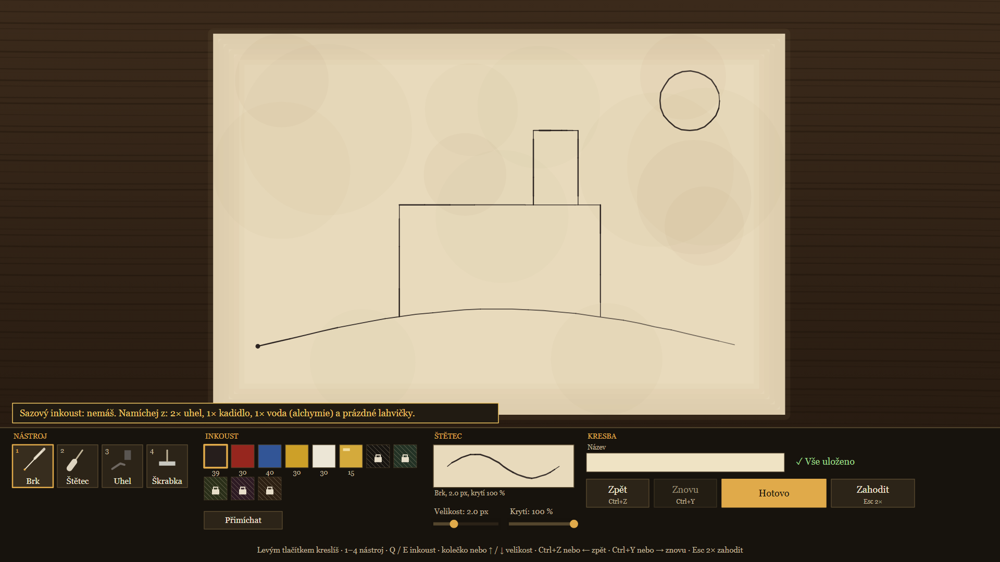
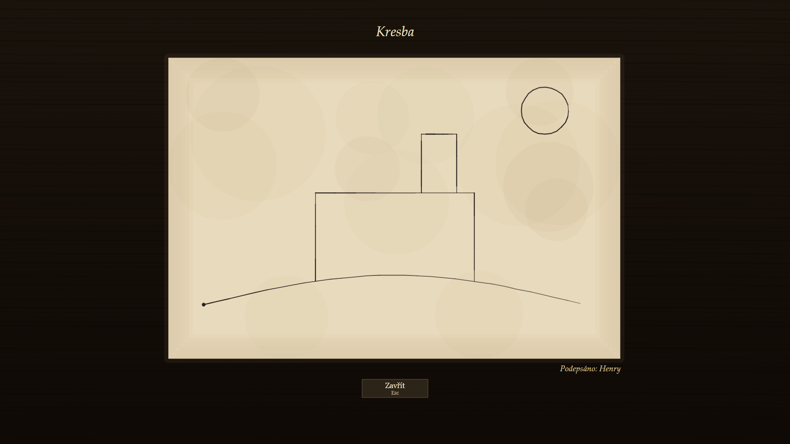

# Drawings (Kresby) for Kingdoms Connected

Player drawings for **Kingdoms Connected** (KCDC, the Kingdom Come: Deliverance II multiplayer platform): notice
boards and easels in the world, inks and mixed colours, drawings carried in the bag, read up close with the camera.
Finished drawings appear in the world as lit textures with shadows. Other resources build on it through an API
(boards, sheets, drawing sessions without materials, baking textures), for example the
[School](https://github.com/gingygames/kcdc-skola).

## Preview

Drawing on the canvas (brush, charcoal, inks mixed from alchemy ingredients) and a finished drawing read up close.
Rendered from the module's UI outside the game; in game the same page is a web view over the 3D scene.

| Canvas | Viewing a drawing |
|---|---|
|  |  |

## Build and install

```
cd kresby/kcdc
npm ci
npm test                                                   # builds dist/kresby, runs the tests
node tools/build.mjs --out <server>/resources/kresby
```

Settings: F10 → Settings → Drawings (with `sprava` from [gingy-kcdc](https://github.com/gingygames/gingy-kcdc)), or
`resources/kresby/kresby_config.js`. The KCDC module is in `kresby/kcdc`; `kresby/server/kresby_png.lua` is the
KCD:MP codec, used only by a compatibility test.

## Requirements and install notes

- **Node 24+** for the build and the tests. `npm test` also runs a codec compatibility test against the KCD:MP Lua
  codec, which needs **Python 3 with the `lupa` package** (`pip install lupa`); without Python or `lupa` that test is
  skipped and the rest of the suite still passes.
- **The resource folder must be named `kresby`**: the HTML canvas is served from `fw://resources/kresby/ui/platno.html`
  and storage keys start with `kresby:`.
- **Finished drawings become game textures.** The server bakes them into auto-created script-less resources
  `resources/kresby-obrazy-N` (do not delete them by hand). A changed package has to be reloaded before players see
  the drawing: provide `KRESBY_CONFIG.svet.reload(novych, zmenenych)` in `kresby_config.js` (send `refresh` +
  `start <name>` for new packages and `restart <name>` for changed ones to the server console: RCON, your own console
  bridge, anything), or restart the server. Without either, sheets stay blank until the next restart. The default
  `svet.konzole: true` only matters on the gingy-kcdc playground (it looks for `logs/playground.pid`); set it to
  `false` elsewhere.
- **`most` is optional** (storage, identity and permissions from the framework; see the gingy-kcdc repository).
  Without it, `admini: []` in `kresby_config.js` must list the nicknames allowed to build boards, place the scribe
  shop and moderate, and boards are stored in `<server>/data/most-shim/kresby.json`.
- **`tearDown`** in `kresby_config.js` says who may tear a sheet off a board: `"anyone"` (default), `"author"` or
  `"admin"`. On a public server `"author"` is recommended, otherwise anyone can remove other players' drawings.

## Documentation

- [kresby/kcdc/README.md](kresby/kcdc/README.md): module description, controls, settings (Czech).
- [kresby/kcdc/AGENTS.md](kresby/kcdc/AGENTS.md): API for other resources, custom UI (`setUi`), architecture.

## For AI agents

See [AGENTS.md](AGENTS.md): layout, commands and rules for agents working in this repository.

## Source

This repository is generated from the monorepo [gingygames/gingy-kcdc](https://github.com/gingygames/gingy-kcdc)
(`kresby/kcdc`) together with the shared code it compiles in (same folder layout). Details in [ZDROJ.md](ZDROJ.md).
Report issues here; changes are made in gingy-kcdc and mirrored.

## License

MIT, see [LICENSE](LICENSE).
