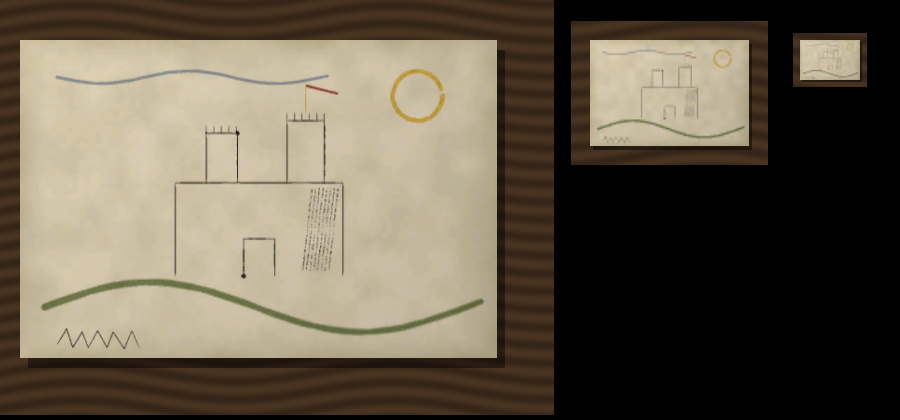

# Kresby pro Kingdoms Connected (KCDC)

Resource `kresby` pro servery [Kingdoms Connected](https://kingdomsconnected.com) (KCD2 multiplayer na MafiaHub Framework, API 1.7.2). **Hlavní verze modulu**, navržená pro API KCDC: streamované assety, `Prop`, Scaleform, `Items`, `most` a editor nastavení ve správě. Verze pro KCD:MP o složku výš ([../README.md](../README.md)) je zmrazená a dostává jen opravy chyb.
- Hráči kreslí na pergamen a papír u vývěsky nebo stojanu ve světě brkem, štětcem, uhlem nebo škrabkou. Používají inkousty z brašny, které jde míchat a ředit.
- Ostatní poblíž vidí kreslení naživo.
- Hotová kresba visí na vývěsce, kde ji vidí všichni, nebo jde do brašny jako předmět. Ten jde prohlédnout, připíchnout jinam i prodat.

**Stav (3. 11. 2026):** ověřené v simulaci (66 testů nad falešným API KCDC, 1 přeskočený bez Pythonu). Na playground serveru (KCDC 1.7.3) běží: balíčky textur `kresby-obrazy-0` a `-1` se zabalí a spustí a server postaví list s texturou kresby jako `Prop` (`/kresby info`: „listů ve světě 1, nepostavených 0“). Od 1. 11. jdou nové kresby do malého horkého balíčku a po startu bez hráčů se přelévají do studených (viz Výkon); balíček, který nastartuje dřív, než kresby dočtou stav z úložiště, počká (3. 11.). **Ve hře s klientem zatím nikdo neověřil, jak list vypadá.** Náhled renderu (simulace osvětlení, ne snímek ze hry): [docs/nahled-svet.png](docs/nahled-svet.png). Integrační body pro cizí server a framework: [AGENTS.md](AGENTS.md).



## Co je nativně a co přes HTML

| Část | Jak | API KCDC |
|---|---|---|
| Kresba na vývěsce ve světě | **osvětlený list se stíny**: server kresbu vykreslí (všechny efekty), uloží jako texturu hry (DDS BC1 s mipmapami) s modelem listu a materiálem do balíčku assetů, list stojí ve světě jako `Prop` (mipmapy, LOD a streamování obstará hra) | `Prop.spawn`, streamované assety (`stream/`), `Items`/`Assets` |
| Ladicí čáry | jen `svet.rezim = "cary"` nebo `"oboji"`: 3D čáry jako dřív (svítí, nemají stíny) | `Gizmos` |
| Kreslicí plátno | obrazovka Scaleformu hry přesně přes list ve světě (kamera zamčená na list), tahy kreslicím API movie clipu; panel Nástroj / Inkoust / Štětec / Kresba (`src/client/platno.ts`, vzhled `theme.ts`, prvky `widgets.ts`) | `NativeUI.createScreen`, `clip.invoke("lineTo" …)`, `Camera.setShot`, `Hud.worldToScreen` |
| Čtení na desce | kamera na list (`Camera.setShot`), čte se přímo osvětlený list ve světě; dokud hráč texturu nemá, ukáže se kresba přes list | `Camera`, `Assets.has`, `NativeUI` |
| Čtení z brašny | inventář se zavře (jinak by prohlížeč překryl), pak Scaleform: pergamen, tahy, název písmem Manuscript, podpis | `NativeUI.setMenuEnabled`, `NativeUI` |
| Nastavení | editor ve správě (F10, `/kresby nastaveni`): inkousty a míchání, materiály a obchod, štětce a efekty, výkon, vývěsky („Vzít moji pozici“), moderace | `sprava.registerSettings` |
| Nabídky (deska, dokončení, kniha) | herní dialog, nebo UI frameworku přes `most.ui.menu` | `Dialogue` |
| Inkousty, listy, kniha, kresba | vlastní předměty: herní předmět jako vzhled, vlastní název, popis a data (kapky, barva, kresba) | `Items.register`, `Inventory.add/updateCustom` |
| Kniha o barvách | nativní kniha hry v rukou (recepty), dílna jako dialog | `Book.open` |
| Krám písaře | obchod hry (groše hry), každý recept má vlastní typ lahvičky | `Vendor` |
| Stojan | podstavec listu: dřevěná tabule na sloupku (`sign_wall_board_rustic.cgf`, výchozí) nebo malířský stojan (`canvas_stand_a.cgf`); natočení a poloha líce změřené z geometrie modelu v `src/shared/stojany.ts` (přední strana tabule je −Y, stojanu +X) | `Prop.spawn` |
| List | model listu je jednostranný a má rub (zezadu je vidět čistý rub listu, ne zrcadlená kresba); modely hotových kreseb se při startu přepíšou na novou verzi (`VERZE_MODELU` v `assets.ts`) | |
| Vývěska | rovina na povrchu, kam se správce dívá (herní vývěska, zeď) | `World.raycast` přes klienta správce |
| U desky | nápověda akce hry na klávese | `ActionHint` |
| Oznámení | notifikace hry, nebo `most.notify` | `Hud.showNotification` |
| **HTML (CEF)** | **jen záloha** kreslicího plátna a prohlížení (`ui/platno.html`), když Scaleform kreslit neumí (zkouška při otevření) nebo když to nastavíte; vzhled ze sdílené sady `ui-kit/` (build ji kopíruje do `ui/kit/`), nativní panel bere stejné barvy (`src/client/theme.ts`) | `Web.createView` |

## Vztah k verzi pro KCD:MP

Verze pro KCD:MP je zmrazená. Společný je jen formát kresby: KCDC zapisuje `k3` a umí přečíst i `k2` z KCD:MP (dovoz starých kreseb; `test/codec.test.ts` to kontroluje proti `../server/kresby_png.lua`). Rastr textury (`src/server/raster.ts`) vychází z jejího vykreslení, aby kresba vypadala stejně. Všechno ostatní (úložiště, předměty, svět, UI, nastavení) je postavené na API KCDC.

## Výkon (simulace, Node 24, `npm test`)

| Co | Výsledek |
|---|---|
| Kresba na stropu (13 323 bodů) | k2 57 kB, **k3 15,6 kB**; zakódovat 4,9 ms, dekódovat 2,1 ms |
| Textura listu 1024 × 512 (BC1, 8 mipmap) | **~350 kB** na kresbu (512 × 256 ≈ 90 kB, `svet.sirka`), rozdělená jako textury hry (`.dds` + `.dds.1`–`.4`); celé pečení (rastr, převzorkování, mipmapy, BC1) po kouscích: kresba na stropu 160 ms ve 2 450 krocích, nejdelší krok 0,4 ms, server dostane tick po `svet.rozpocetMs` (6 ms). Dřív převzorkování + mipmapy + BC1 naráz 55–75 ms (2048: ~190 ms). Buffery (~50 MB) se mezi kresbami používají znovu, soubory se zapisují přes `fs.promises` |
| Balíček assetů | nové kresby za běhu do **horkého balíčku** (`svet.horky` = 3 kresby, ≤ 1 MB): nová kresba = připojení hráči stáhnou jen ten (64 hráčů ≈ 65 MB, dřív plný balíček 24 kreseb 8,2 MB = 525 MB). Studené balíčky (`svet.shard` = 24) se za běhu nemění ani po smazání; při startu serveru bez hráčů se horké kresby přelijí do nich |
| Po přenačtení balíčku | zprávu `EV.deska` dostanou jen desky s kresbou, která právě přestala čekat (dřív všechny desky všem: ~830 zpráv / 580 kB při 64 hráčích) |
| Živé kreslení u diváka | nové tahy se dokreslí do dalších kreseb Gizmos, celý list se přestaví po zpět a nejvýš 1× za s; kresba až do stropu (320 tahů po dvou): 138 ms klienta za 24 s kreslení, 745× `Gizmos.set` (dřív 1 059 ms, 136 plánů celé kresby, 2 989× `Gizmos.set`) |
| Nativní plátno: zpět | tahy po blocích 32 v podřízených clipech, zpět překreslí jen poslední blok: ~2 300 volání Scaleformu, 2 snímky (dřív celé plátno ~25 600 volání, 17 snímků s blikáním); šířka čáry po ~12 % (o 14 % méně `lineStyle`) |
| Ve světě | jeden `Prop` na list, hra ho streamuje a kreslí se svými mipmapami a LOD; žádné vlastní vykreslování v klientu |
| Město: 50 vývěsek, 300 kreseb (1,3 mil. bodů) | 1,56 MB dat v úložišti, ~100 MB textur na disku serveru (13 balíčků); start serveru 2 ms |
| Přepočet okolí pro 64 hráčů | 0,9 ms za průchod (1× za s); popisy desek ~7 kB na hráče za 20 s chůze |

Čitelnost (náhled nahoře): z 1 m list zabírá ~480 px a čte se mipmapa 512 × 256, z 3 m ~160 px (mipmapa 128 × 64) - obrys a barvy, tenký brk splývá, z 8 m jen celkový dojem. Na čtení detailu je „Prohlédnout“ (kamera na list).

## Build a nasazení
Potřebuje Node 24+. Na test kompatibility s KCD:MP navíc Python 3 s `lupa`.
```sh
cd kresby/kcdc
npm install
npm run build                                        # dist/kresby/
npm test                                             # build + 66 testů (kodek, synchronizace, server, textury a balíčky, nastavení, výkon); bez Pythonu s lupa se 1 přeskočí
npm run perf                                         # jen výkonové testy s čísly (test/perf.test.ts)
node node_modules/esbuild/bin/esbuild tools/nahled.ts --bundle --platform=node --outfile=dist/nahled.cjs && node dist/nahled.cjs   # náhled renderu -> docs/nahled-svet.png
node tools/build.mjs --out <server KCDC>/resources/kresby   # nasazení (kresby_config.js se nepřepisuje)
```
Resource: `package.json` (manifest `mafiahub`), `kresby_config.js`, `server.js`, `client.js`, `ui/platno.html` + `ui/platno.js` + `ui/kit/` (kopie `ui-kit/`). Resource se musí jmenovat `kresby`: HTML plátno je na `fw://resources/kresby/ui/platno.html`. Playground ([../../playground/](../../playground/)) ho najde sám (`*/kcdc/`).

Kresby si za běhu zakládají vedle sebe resource **`kresby-obrazy-0`, `-1`, …** (balíčky textur, bez skriptů; nemazat ručně) a po nové kresbě je přenačtou: na playgroundu samy přes jeho konzoli (`logs/playground.pid`), na jiném serveru přes hák `KRESBY_CONFIG.svet.reload(novych, zmenenych)` (`refresh` + `start` u nových, `restart` u změněných). Bez háku se nové textury ukážou po restartu serveru, do té doby visí čistý list. Viz [AGENTS.md](AGENTS.md).

Doporučené: resource `most` (v manifestu kreseb jako závislost není, aby se kresby nerestartovaly s ním; kresby se na něj napojí, i když naběhne později), který dodá úložiště, práva a identitu postav. Bez něj platí `kresby_config.js` a záloha shimu mostu: vývěsky se ukládají do `<server>/data/most-shim/kresby.json`, id postavy je `steam:<id>` (jinak `nick:<přezdívka malými>`) jako ve standalone mostu. Kresby v brašnách se neztratí, pokud framework ukládá inventáře. Volitelný je resource `sprava` s panelem Kresby. Závislost na něj v manifestu není, Správa si panel stáhne z exportu `spravaPanels`.

## API pro jiné resources (škola)

`src/server/api.ts`, exporty v manifestu. Chyba (výjimka, i u asynchronních exportů odmítnutý promise) se volajícímu vrací jako text, export nikdy nevyhodí. Desky s vlastníkem (`owner`) nejdou použít přes nabídku kreseb (nic se z nich nestrhne, nekreslí se na ně bez relace vlastníka). Hotová kresba visí na listu a upeče se do textury jako každá jiná.

| Export | Co |
|---|---|
| `boardCreate({ owner, kind?, pos, n, w, h?, cols?, rows?, yaw?, model? })` | deska / stojan, vrací id nebo text chyby |
| `boardRemove(id, owner)` | smaže desku i její kresby |
| `boardDraw(playerId, id, slot, { owner, paper?, inks, tools?, base?, title?, hang?, done? })` | volná relace kreslení: bez materiálu, inkousty od volajícího, `base` = předloha / dosavadní obsah (zpět ji nevezme), hotovo bez dialogu: nahradí list (`hang`) a zavolá `done` (+ událost `kresby:hotovo`) |
| `boardPut(id, slot, "k3.", { owner, title?, author? })` | vloží kresbu skriptem (ruční písmo školy) |
| `boardClear(id, slot, owner)`, `boardGet(id, slot)`, `boardInfo(id)`, `stopDrawing(playerId)` | smazat list, přečíst kresbu, popis desky, ukončit relaci |
| `paperCode("tabule")` | kód listu (31 = školní tabule, `SYSTEM_PAPERS` v `shared/look.ts`, neprodává se) |
| `drawingPrepare(owner, "k3.", { title?, author? })`, `boardShow(id, slot, drawingId, owner)` | sdílená kresba: upeče se jednou a visí na libovolně deskách (jedna textura); s listem se nemaže |
| `drawingReady(drawingId)`, `drawingDelete(drawingId, owner)` | je textura v běžícím balíčku; smazat sdílenou kresbu všude |
| `boardBake(id, slot, owner)` | upéct kresbu pověšenou s `bake: false` |
| `setCaptionFilter(fn, owner)` (server i klient) | filtr popisků kreseb: server `fn(pid, text, seed)`, klient `fn(text, seed)`; zmizí se zastavením vlastníka |

**Živé kreslení v režimu textur:** listy, na které se právě kreslí, a hotové kresby, jejichž textura se ještě peče nebo se péct nemá (`SlotMsg.pend`), kreslí klient čarami (Gizmos) přes čistý list (Prop); jakmile je textura v běžícím balíčku, čáry zmizí a zůstane osvětlená textura. List s přesýpacími hodinami (`ceka`) se už nepoužívá, „načítá se“ hlásí jen prohlížeč.

**Odložené pečení:** `boardDraw` / `boardPut` s `bake: false` kresbu pověsí bez textury (klienti ji kreslí čarami), `boardBake(id, slot, owner)` ji upeče později. Škola tak peče tabuli jednou na konci hodiny místo po každém „Hotovo“.

**Plátno volné relace** (`boardDraw`): `CanvasMsg.unlimited` = bez počtu kapek a zamčených receptů, `CanvasInk.pick: false` = inkoust jen pro předlohu (na plátně se nedá vybrat, server tah jím odmítne), jména inkoustů od volajícího.

Desky s vlastníkem nejsou v nastavení kreseb (F10) a klient u nich neukazuje nápovědu akce kreseb. Přepsaná nebo smazaná kresba desky vlastníka se smaže i s texturou.

## Příkazy
Hráč: klávesa u vývěsky (výchozí `F`, nápověda akce hry) → nabídka: kreslit na pergamen / papír, připíchnout kresbu z brašny, prohlédnout, strhnout list. Použít knihu o barvách → dílna. Použít kresbu v brašně → prohlédnout.

Plátno: kreslí se myší po listu. Panel dole obsahuje nástroje (brk, štětec, uhel, škrabka), kalíšky inkoustů se zbývajícími kapkami, „Přimíchat“ (druhý inkoust a poměr), posuvníky velikost 0,5–40 px a krytí 5–100 %, název kresby, Zpět, Hotovo a Zahodit (dvakrát). Esc dvakrát kresbu zahodí.

Správce (`kresby.admin` nebo obecné `admin` mostu, moderace `kresby.moderate`):

| Příkaz | Co dělá |
|---|---|
| `/kresby tabule [sloupce] [řádky] [šířka m] [výška m]` | vývěska na povrchu, kam se díváte (výchozí 3 × 2, 1,5 m) |
| `/kresby stojan [šířka m]` | stojan 1,2 m před vámi |
| `/kresby kram` | krám písaře tam, kam se díváte |
| `/kresby smazat` | nejbližší deska do 5 m (kresby zůstanou v úložišti) |
| `/kresby dat <hráč> pergamen\|papir\|kniha\|nastroje\|sada [počet]` | materiál |
| `/kresby dat <hráč> inkoust <číslo nebo id receptu>` | lahvička (`dubenka`, `saze`, `trezalka`, `mesicek`, `medenka`, `modr`, `kopriva`, `bez`, `asfalt`, `beloba`, `zlato`) |
| `/kresby info` | počty, úložiště, napojení na most |
| `/kresby kdo` | listy na nejbližší desce s čísly kreseb |
| `/kresby skryt <id>` / `obnovit <id>` / `vymazat <id>` | zabavit / vrátit / smazat kresbu |
| `/kresby ladit` | obrysy desek a listů na 60 s |
| `/kresby nastaveni [cesta]` | editor nastavení ve správě (F10), např. `/kresby nastaveni inkousty.recepty.zlato` |

V konzoli serveru: `kresby info` (stav, listy ve světě, textury, přenačtení balíčků).

Stejné akce jsou i v panelu **Kresby** ve správě: kresby poblíž s tlačítky zabavit / vrátit / smazat, prohlédnout, dát materiál, postavit, desky poblíž, stav.

## Co ověřit ve hře (postup)
1. Připojit se na playground, dojít k vývěsce (stojan s kresbou č. 10 u kostela, `/kresby kdo`). **List musí být osvětlený jako okolí, se stínem na desce, ne svítit.** Když list chybí nebo je fialový / černý: v `KCDC.log` hledat `kresby-obrazy`; `svet.rezim` přepnout na `cary` ve správě a nahlásit.
2. Orientace listu: kresba čitelná zleva doprava, nahoře je horní okraj (jinak otočit osy v `src/shared/layout.ts` → `quatFromBasis`).
3. Nakreslit novou kresbu a nechat ji viset: hned visí čistý list a tahy přes něj čarami, za ~30 s (`svet.reloadS`) se vymění za kresbu (balíček se stáhne bez odpojení). **Od 1. 11.:** server se při pečení nesmí zaškobrtnout (hráči kolem se hýbou plynule), přenačte se jen horký balíček (`/kresby info` → „Textury: … horkých“, v logu `přenačítám balíčky textur: restart kresby-obrazy-N` s jedním malým balíčkem) a ostatní hráči nemají při přenačtení zásek. Po restartu serveru (bez hráčů) log `… přesunuto do studených` a kresby visí dál. Divák u cizího kreslení: čáry přibývají plynule, žádné blikání celého listu. Plátno: Ctrl+Z u plného listu nebliká (zmizí jen poslední tah).
4. „Prohlédnout“ na desce: kamera plynule přelétne na list (0,7 s), Esc nebo pohyb plynule zpět, postava se během přeletu nehne. Dokud se textura načítá, ukáže se kresba přes list s hláškou „načítá se“. Z brašny: inventář se zavře a ukáže se kresba (Esc / Enter zavře až po 0,6 s).
5. F10 → Nastavení → Kresby: přidat inkoust (barva, suroviny), uložit, `/kresby dat <já> inkoust <id>`; přidat druh listu; přesunout vývěsku přes „Vzít moji pozici a směr“.
6. Čitelnost z 1, 3 a 8 m proti náhledu ([docs/nahled-svet.png](docs/nahled-svet.png)), FPS u vývěsky s 6 kresbami.
7. Plátno (snímky bez hry: `.snimky/pred-*.png` a `po-*.png`, `node tools/nahled-ui.mjs [předpona]`; složka `.snimky/` je jen místní, ve veřejném zrcadle není):
   - nástroj jedním klikem nebo klávesou 1–4; nástroj, který hráč nemá, je zašedlý a řekne proč;
   - inkousty: všechny vidět, zamčené šrafované se zámečkem, klik řekne, kde je sehnat; Q / E přepíná;
   - náhled stopy v panelu odpovídá velikosti na listu; kolečko nebo ↑ / ↓ mění velikost;
   - **Ctrl+Z / Ctrl+Y**: když je hra při fokusu obrazovky nepustí (UI drží vstup), fungují ← / → a tlačítka; nahlásit, co platí;
   - stav vpravo: „Ukládám n tahů…“ → „✓ Vše uloženo“, po Hotovo „Ukládám…“;
   - latence: po zavření plátna je v logu klienta `plátno: N vzorků myši, vzorek -> čára …, odstup vzorků …`; čára má jít za myší bez znatelného zpoždění.
8. Dříve: Scaleform plátno (`lineTo`, `_xmouse`), `ActionHint` (klávesa `f` hra nezná: klient použije `Key.bind` a infotext), vzhledy předmětů, `Vendor` s daty kusu.

Zjištěno na serveru: KCDC odmítne zalomení řádku v textu předmětu (`Invalid custom item text`), a `resourceStart` balíčku přijde dřív, než je balíček zabalený (`Prop.spawn` s jeho modelem jde až o chvíli později, kresby to opakují).

## Soubory
- `src/shared/`: kodek (`codec.ts`), inkousty a spotřeba (`ink.ts`, stejné vzorce jako KCD:MP), vzhled z nastavení (`look.ts`: druhy listů, efekty nástrojů), vektorové vykreslení (`vector.ts`, plátno a ladicí čáry), geometrie desek (`layout.ts`), protokol (`protocol.ts`).
- `src/server/`: `main.ts` (události), `most.ts` (napojení na framework), `store.ts` (úložiště), `materials.ts`, `boards.ts` (desky a zájem), `sessions.ts` (živé kreslení), `drawings.ts` (předměty, nabídka u desky, moderace, data), `admin.ts` (příkazy a panel správy), `settings.ts` (editor nastavení ve správě), `config.ts`; textury ve světě: `raster.ts` (rastr s efekty, převod `kresby_png.lua`), `dds.ts` (textura hry), `cgf.ts` (model listu a materiál), `assets.ts` (balíčky `kresby-obrazy-N`: horké a studené, přenačtení s generacemi, pečení po kouscích), `props.ts` (listy jako Prop).
- `src/client/`: `main.ts`, `hooks.ts` (vyměnitelné UI), `session.ts` (relace, dávky, kamera), `native.ts` (Scaleform), `web.ts` + `src/web/platno.ts` + `ui/platno.html` (záložní HTML), `world.ts` (Gizmos, LOD, data).
- `test/`: falešné API (`fake.ts`), testy kodeku, synchronizace, serveru, textur (`assets.test.ts`), nastavení (`settings.test.ts`, i proti `sprava/src/settings-core.ts`) a výkonu. `tools/nahled.ts` vyrobí náhled renderu. `tools/lua_k2.py` kontroluje k2 proti `../server/kresby_png.lua`.
